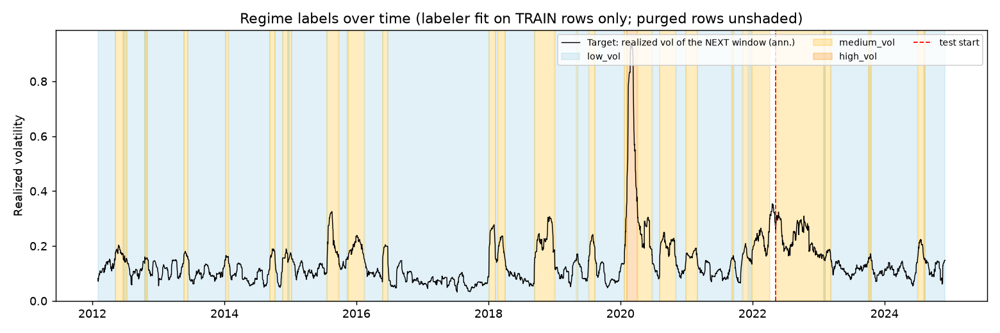
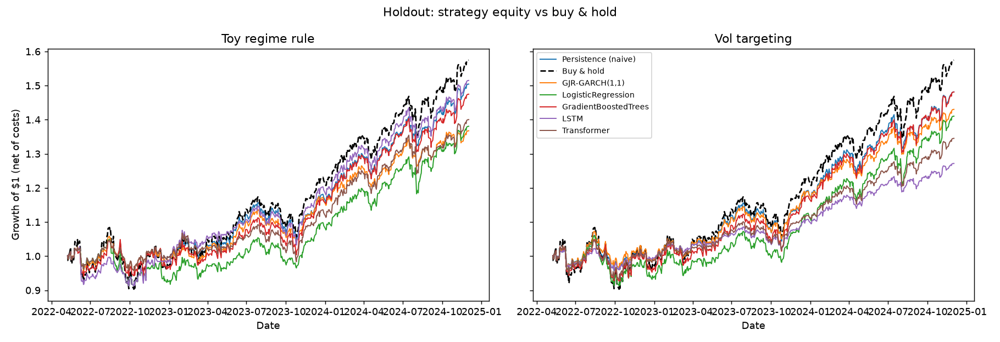
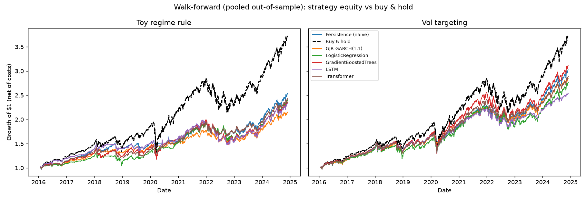
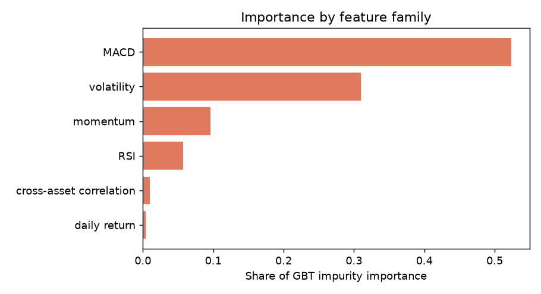

# Volatility Regime Forecasting - Results Report

Generated: 2026-11-02T01:34:03

## 1. Task and experimental design

Predict the volatility regime (low_vol, medium_vol, high_vol) of `SPY` with `gmm` regimes. Label mode: **forward** - the target for day *t* is the realized volatility of days *t+1 ... t+20*; the inputs describe days up to *t*, so the two share no days. The regime labeler and the feature scaler are fit on training rows only. A purge gap of **20 trading days** separates train from test so no training label window reaches into the test period.

Universe: 9 tickers, 2012-01-03 to 2024-12-31, daily adjusted closes.

## 2. Holdout results (single chronological split)

Train: 2012-02-01 to 2022-04-07 (2564 rows). Test: 2022-05-09 to 2024-12-02 (646 rows). Every model is scored on exactly these test dates.

Test-window class shares: low_vol 62.5%, medium_vol 37.5%, high_vol 0.0%.

> **Regime(s) absent from the test window: high_vol.** Models were never tested on them in this split, and macro-F1 averages only the regimes that occur. See the walk-forward section for coverage of rarer regimes.

Reference floors: random guessing = **0.333**, always predicting the most common training regime = **0.625** (on this test window), persistence = **0.861**.

| model                |   accuracy |   macro-F1 (present classes) |   macro-F1 (all classes) |   acc - persistence |
|:---------------------|-----------:|-----------------------------:|-------------------------:|--------------------:|
| Persistence (naive)  |      0.861 |                        0.854 |                    0.569 |               0.000 |
| GradientBoostedTrees |      0.810 |                        0.785 |                    0.523 |              -0.051 |
| Transformer          |      0.791 |                        0.785 |                    0.524 |              -0.070 |
| LSTM                 |      0.769 |                        0.754 |                    0.502 |              -0.091 |
| GJR-GARCH(1,1)       |      0.768 |                        0.764 |                    0.510 |              -0.093 |
| LogisticRegression   |      0.745 |                        0.727 |                    0.485 |              -0.116 |

**No ML model beats the persistence baseline on holdout accuracy.** On this split the models add no measurable skill over "tomorrow's regime = today's regime".

Confusion matrices: `outputs/figures/confusion_matrix_<model>.png` (rows = true, columns = predicted).

Counts below are rows = true regime (low, medium, high), columns = predicted:

```
Persistence (naive)
    349    55     0
     35   207     0
      0     0     0
```

```
GJR-GARCH(1,1)
    302   102     0
     42   194     6
      0     0     0
```

```
LogisticRegression
    322    82     0
     83   159     0
      0     0     0
```

```
GradientBoostedTrees
    371    33     0
     90   152     0
      0     0     0
```

```
LSTM
    343    61     0
     76   154    12
      0     0     0
```

```
Transformer
    327    70     7
     58   184     0
      0     0     0
```

## 3. Walk-forward validation (expanding window, purged)

9 folds, each testing on ~252 trading days that follow the training window. The regime labeler, scaler and every model are re-fit per fold on that fold's training rows. **Regimes are relative to each fold's own training distribution** (a calm training period labels smaller spikes as "high"), so the meaning of a regime shifts slightly between folds.

**Accuracy by fold**

| fold   | test_start   | test_end   |   regimes in test |   high-vol share |   GJR-GARCH(1,1) |   GradientBoostedTrees |   LSTM |   LogisticRegression |   Persistence (naive) |   Transformer |
|:-------|:-------------|:-----------|------------------:|-----------------:|-----------------:|-----------------------:|-------:|---------------------:|----------------------:|--------------:|
| fold1  | 2016-01-25   | 2017-01-23 |                01 |            0.000 |            0.579 |                  0.655 |  0.405 |                0.365 |                 0.667 |         0.623 |
| fold2  | 2017-01-24   | 2018-01-23 |               012 |            0.044 |            0.794 |                  0.623 |  0.496 |                0.361 |                 0.952 |         0.468 |
| fold3  | 2018-01-24   | 2019-01-24 |               012 |            0.381 |            0.381 |                  0.484 |  0.337 |                0.262 |                 0.548 |         0.321 |
| fold4  | 2019-01-25   | 2020-01-24 |               012 |            0.075 |            0.464 |                  0.500 |  0.294 |                0.409 |                 0.409 |         0.456 |
| fold5  | 2020-01-27   | 2021-01-25 |               012 |            0.615 |            0.448 |                  0.325 |  0.468 |                0.393 |                 0.468 |         0.258 |
| fold6  | 2021-01-26   | 2022-01-24 |                01 |            0.000 |            0.651 |                  0.690 |  0.738 |                0.694 |                 0.702 |         0.694 |
| fold7  | 2022-01-25   | 2023-01-25 |                01 |            0.000 |            0.865 |                  0.325 |  0.484 |                0.433 |                 0.984 |         0.774 |
| fold8  | 2023-01-26   | 2024-01-26 |                01 |            0.000 |            0.706 |                  0.766 |  0.734 |                0.595 |                 0.813 |         0.690 |
| fold9  | 2024-01-29   | 2024-12-02 |                01 |            0.000 |            0.776 |                  0.818 |  0.879 |                0.776 |                 0.813 |         0.766 |

**Mean and spread across folds**

| model                |   accuracy mean |   accuracy std |   macro-F1 mean |   macro-F1 std | folds beating persistence   |
|:---------------------|----------------:|---------------:|----------------:|---------------:|:----------------------------|
| Persistence (naive)  |           0.706 |          0.204 |           0.458 |          0.140 | 0/9                         |
| GJR-GARCH(1,1)       |           0.629 |          0.171 |           0.466 |          0.111 | 1/9                         |
| GradientBoostedTrees |           0.576 |          0.179 |           0.399 |          0.132 | 2/9                         |
| Transformer          |           0.561 |          0.192 |           0.370 |          0.122 | 1/9                         |
| LSTM                 |           0.537 |          0.201 |           0.391 |          0.163 | 2/9                         |
| LogisticRegression   |           0.476 |          0.172 |           0.354 |          0.109 | 0/9                         |

**Pooled out-of-sample predictions (all folds together)**

| model                |   accuracy |   macro-F1 (all classes) |   acc - persistence |
|:---------------------|-----------:|-------------------------:|--------------------:|
| Persistence (naive)  |      0.704 |                    0.648 |               0.000 |
| GJR-GARCH(1,1)       |      0.627 |                    0.587 |              -0.078 |
| GradientBoostedTrees |      0.572 |                    0.466 |              -0.132 |
| Transformer          |      0.558 |                    0.462 |              -0.147 |
| LSTM                 |      0.531 |                    0.467 |              -0.173 |
| LogisticRegression   |      0.471 |                    0.394 |              -0.233 |

The high-volatility regime appears in 4 of 9 test windows, so crisis behaviour is tested here in a way the single holdout cannot. Figure: `outputs/figures/walk_forward_accuracy.png`.

## 4. Regime labels

Primary-split labeler (`gmm`, fit on training rows only): mean volatility by regime on training data = low_vol 0.098, medium_vol 0.208, high_vol 0.687.



## 5. Strategy layer (illustrative only)

Two rules on `SPY`: the original **toy regime rule** (`exposure = 1 - regime/(K-1)`) and **volatility targeting** (`exposure = 12% / predicted vol`, capped at 1.0x). Costs: 5 bps per unit of turnover on every rule; un-invested cash earns the risk-free rate (2%). Exposure decided at the close of day *t* earns day *t+1*'s return. All models and buy & hold are measured on identical days. Vol targeting with the **Persistence** row is simply "scale by recent realized vol" - the no-ML benchmark a forecaster has to beat to justify itself.

**Holdout (2022-05-09 to 2024-12-02, 646 days)**

| model                | rule            |   Sharpe (net) |   Sharpe (gross) |   CAGR (net) |   ann. vol |   max drawdown |   avg exposure |   turnover / yr |
|:---------------------|:----------------|---------------:|-----------------:|-------------:|-----------:|---------------:|---------------:|----------------:|
| Buy & hold           | -               |          1.034 |            1.034 |        0.194 |      0.165 |         -0.167 |          1.000 |           0.000 |
| Persistence (naive)  | Toy regime rule |          1.286 |            1.297 |        0.173 |      0.113 |         -0.100 |          0.797 |           2.536 |
| Persistence (naive)  | Vol targeting   |          1.222 |            1.238 |        0.166 |      0.115 |         -0.097 |          0.800 |           3.664 |
| GJR-GARCH(1,1)       | Toy regime rule |          0.996 |            1.056 |        0.130 |      0.108 |         -0.095 |          0.762 |          12.873 |
| GJR-GARCH(1,1)       | Vol targeting   |          1.112 |            1.162 |        0.150 |      0.113 |         -0.100 |          0.772 |          11.227 |
| LogisticRegression   | Toy regime rule |          0.912 |            0.954 |        0.134 |      0.125 |         -0.129 |          0.813 |          10.337 |
| LogisticRegression   | Vol targeting   |          0.944 |            0.980 |        0.144 |      0.130 |         -0.138 |          0.839 |           9.174 |
| GradientBoostedTrees | Toy regime rule |          1.064 |            1.099 |        0.164 |      0.132 |         -0.102 |          0.857 |           9.167 |
| GradientBoostedTrees | Vol targeting   |          1.052 |            1.081 |        0.166 |      0.135 |         -0.116 |          0.880 |           7.806 |
| LSTM                 | Toy regime rule |          1.184 |            1.197 |        0.176 |      0.127 |         -0.112 |          0.815 |           3.316 |
| LSTM                 | Vol targeting   |          1.027 |            1.039 |        0.098 |      0.074 |         -0.063 |          0.487 |           1.751 |
| Transformer          | Toy regime rule |          1.009 |            1.023 |        0.140 |      0.117 |         -0.100 |          0.793 |           3.316 |
| Transformer          | Vol targeting   |          0.942 |            0.950 |        0.123 |      0.108 |         -0.109 |          0.659 |           1.805 |



**Walk-forward, pooled out-of-sample (2016-01-25 to 2024-12-02, 2230 days)**

| model                | rule            |   Sharpe (net) |   Sharpe (gross) |   CAGR (net) |   ann. vol |   max drawdown |   avg exposure |   turnover / yr |
|:---------------------|:----------------|---------------:|-----------------:|-------------:|-----------:|---------------:|---------------:|----------------:|
| Buy & hold           | -               |          0.814 |            0.814 |        0.161 |      0.178 |         -0.337 |          1.000 |           0.000 |
| Persistence (naive)  | Toy regime rule |          0.919 |            0.938 |        0.111 |      0.098 |         -0.143 |          0.733 |           3.560 |
| Persistence (naive)  | Vol targeting   |          0.996 |            1.010 |        0.133 |      0.112 |         -0.147 |          0.826 |           3.055 |
| GJR-GARCH(1,1)       | Toy regime rule |          0.776 |            0.854 |        0.091 |      0.091 |         -0.150 |          0.705 |          14.182 |
| GJR-GARCH(1,1)       | Vol targeting   |          0.940 |            0.982 |        0.126 |      0.111 |         -0.142 |          0.825 |           9.369 |
| LogisticRegression   | Toy regime rule |          0.723 |            0.787 |        0.104 |      0.119 |         -0.216 |          0.735 |          15.256 |
| LogisticRegression   | Vol targeting   |          0.746 |            0.778 |        0.122 |      0.141 |         -0.211 |          0.867 |           9.143 |
| GradientBoostedTrees | Toy regime rule |          0.665 |            0.723 |        0.102 |      0.129 |         -0.262 |          0.818 |          14.973 |
| GradientBoostedTrees | Vol targeting   |          0.800 |            0.824 |        0.137 |      0.150 |         -0.262 |          0.914 |           7.195 |
| LSTM                 | Toy regime rule |          0.693 |            0.711 |        0.101 |      0.120 |         -0.257 |          0.747 |           4.407 |
| LSTM                 | Vol targeting   |          0.727 |            0.736 |        0.111 |      0.129 |         -0.242 |          0.745 |           2.434 |
| Transformer          | Toy regime rule |          0.770 |            0.787 |        0.106 |      0.113 |         -0.156 |          0.744 |           4.012 |
| Transformer          | Vol targeting   |          0.818 |            0.825 |        0.127 |      0.133 |         -0.242 |          0.815 |           1.867 |



Read these as a comparison of *rules and forecasts under the same assumptions*, not as evidence of a tradable edge: one asset, one history, simple cost model, no capacity or tax effects.

## 6. What drives the gradient-boosted model

| family                  |   share of GBT impurity importance |   sum of permutation accuracy drop |   n_features |
|:------------------------|-----------------------------------:|-----------------------------------:|-------------:|
| MACD                    |                              0.523 |                             -0.002 |           27 |
| volatility              |                              0.310 |                              0.111 |           27 |
| momentum                |                              0.096 |                              0.023 |           27 |
| RSI                     |                              0.057 |                              0.004 |            9 |
| cross-asset correlation |                              0.010 |                             -0.003 |            1 |
| daily return            |                              0.004 |                             -0.003 |            9 |

Top individual features by permutation importance on the test window:

| feature         | family     |   gbt_impurity |   perm_acc_drop_mean |
|:----------------|:-----------|---------------:|---------------------:|
| XLK_vol_20d     | volatility |         0.0914 |               0.0517 |
| XLE_macd_signal | MACD       |         0.1430 |               0.0173 |
| XLE_vol_20d     | volatility |         0.0252 |               0.0139 |
| QQQ_vol_20d     | volatility |         0.0053 |               0.0133 |
| QQQ_vol_5d      | volatility |         0.0100 |               0.0108 |
| XLE_vol_10d     | volatility |         0.0422 |               0.0102 |
| XLK_vol_10d     | volatility |         0.0061 |               0.0087 |
| XLK_mom_10d     | momentum   |         0.0051 |               0.0074 |
| TLT_macd_hist   | MACD       |         0.0111 |               0.0071 |
| QQQ_mom_5d      | momentum   |         0.0022 |               0.0062 |



Importance is a description of what the fitted model uses, not proof of a causal driver.

## 7. Explicit limitations

- **Regime labels are a proxy**, produced by an unsupervised model on realized volatility, not ground-truth economic regimes. They are defined relative to each training window.
- **One history.** Walk-forward adds several test windows but they are still one path of one market; rarer regimes have few observations.
- **Single asset target and a small universe** (the configured ETFs), daily adjusted closes only. Intraday realized volatility is not implemented.
- **Simple cost model** (proportional bps on turnover): no slippage that grows with size, no market impact, no taxes, no borrowing spread beyond the risk-free rate.
- **Simple sizing rules.** Vol targeting is implemented; Kelly, risk parity and drawdown control are not.
- **Hyper-parameters are fixed** (not tuned inside each walk-forward fold), which is conservative but not optimal.
- **Persistence and GARCH are strong benchmarks.** If a model does not clearly beat them, the honest conclusion is that it adds little.

## 8. Extension points

- Intraday (e.g. 5-minute) data for a more precise realized-volatility target
- Kelly / risk-parity sizing and drawdown control
- Forecasting with HMM transition probabilities and multi-horizon targets
- Tuning hyper-parameters inside each walk-forward fold
