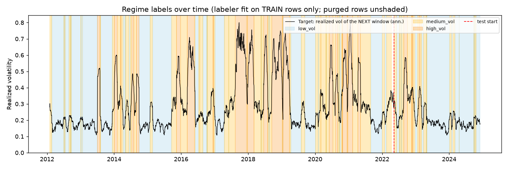
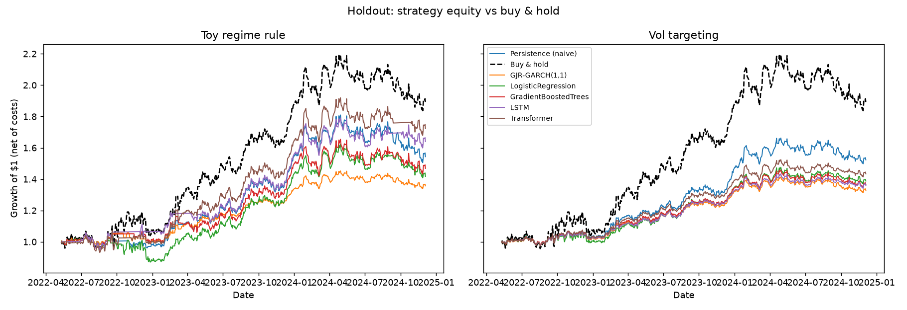
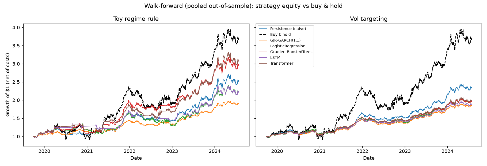
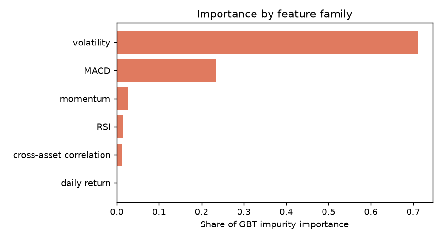

# Volatility Regime Forecasting - Results Report

Generated: 2026-11-01T19:29:02

> **DATA NOTICE: this run used SYNTHETIC data** (regime-switching GBM, not real market prices). Results are for pipeline validation / demo purposes only and must not be read as market findings. Set `use_synthetic: false` in config.yaml and ensure network access to yfinance to reproduce with real data.

## 1. Task and experimental design

Predict the volatility regime (low_vol, medium_vol, high_vol) of `SPY` with `gmm` regimes. Label mode: **forward** - the target for day *t* is the realized volatility of days *t+1 ... t+20*; the inputs describe days up to *t*, so the two share no days. The regime labeler and the feature scaler are fit on training rows only. A purge gap of **20 trading days** separates train from test so no training label window reaches into the test period.

Universe: 9 tickers, 2012-01-02 to 2025-01-01, daily adjusted closes.

## 2. Holdout results (single chronological split)

Train: 2012-01-30 to 2022-04-12 (2662 rows). Test: 2022-05-11 to 2024-12-04 (671 rows). Every model is scored on exactly these test dates.

Test-window class shares: low_vol 65.4%, medium_vol 28.0%, high_vol 6.6%.

Reference floors: random guessing = **0.333**, always predicting the most common training regime = **0.654** (on this test window), persistence = **0.626**.

| model                |   accuracy |   macro-F1 (present classes) |   macro-F1 (all classes) |   acc - persistence |
|:---------------------|-----------:|-----------------------------:|-------------------------:|--------------------:|
| Transformer          |      0.629 |                        0.395 |                    0.395 |               0.003 |
| Persistence (naive)  |      0.626 |                        0.457 |                    0.457 |               0.000 |
| GradientBoostedTrees |      0.626 |                        0.441 |                    0.441 |               0.000 |
| LogisticRegression   |      0.618 |                        0.452 |                    0.452 |              -0.007 |
| LSTM                 |      0.583 |                        0.362 |                    0.362 |              -0.043 |
| GJR-GARCH(1,1)       |      0.250 |                        0.207 |                    0.207 |              -0.376 |

Models with higher holdout accuracy than persistence: Transformer. The margin over persistence, not the headline accuracy, is the measure of added skill.

Confusion matrices: `outputs/figures/confusion_matrix_<model>.png` (rows = true, columns = predicted).

Counts below are rows = true regime (low, medium, high), columns = predicted:

```
Persistence (naive)
    328    99    12
     80    84    24
     11    25     8
```

```
GJR-GARCH(1,1)
      0   431     8
      0   157    31
      0    33    11
```

```
LogisticRegression
    339    86    14
    112    67     9
     12    23     9
```

```
GradientBoostedTrees
    354    75    10
     94    55    39
      8    25    11
```

```
LSTM
    359    11    69
     87    17    84
     26     3    15
```

```
Transformer
    358    55    26
     84    64    40
     29    15     0
```

## 3. Walk-forward validation (expanding window, purged)

5 folds, each testing on ~252 trading days that follow the training window. The regime labeler, scaler and every model are re-fit per fold on that fold's training rows. **Regimes are relative to each fold's own training distribution** (a calm training period labels smaller spikes as "high"), so the meaning of a regime shifts slightly between folds.

**Accuracy by fold**

| fold   | test_start   | test_end   |   regimes in test |   high-vol share |   GJR-GARCH(1,1) |   GradientBoostedTrees |   LSTM |   LogisticRegression |   Persistence (naive) |   Transformer |
|:-------|:-------------|:-----------|------------------:|-----------------:|-----------------:|-----------------------:|-------:|---------------------:|----------------------:|--------------:|
| fold1  | 2019-09-30   | 2020-09-15 |               012 |            0.194 |            0.421 |                  0.448 |  0.437 |                0.508 |                 0.548 |         0.500 |
| fold2  | 2020-09-16   | 2021-09-02 |               012 |            0.385 |            0.587 |                  0.508 |  0.286 |                0.452 |                 0.548 |         0.488 |
| fold3  | 2021-09-03   | 2022-08-22 |               012 |            0.004 |            0.417 |                  0.544 |  0.385 |                0.417 |                 0.595 |         0.460 |
| fold4  | 2022-08-23   | 2023-08-09 |               012 |            0.159 |            0.357 |                  0.452 |  0.433 |                0.492 |                 0.429 |         0.464 |
| fold5  | 2023-08-10   | 2024-07-26 |                01 |            0.000 |            0.087 |                  0.897 |  0.897 |                0.829 |                 0.857 |         0.889 |

**Mean and spread across folds**

| model                |   accuracy mean |   accuracy std |   macro-F1 mean |   macro-F1 std | folds beating persistence   |
|:---------------------|----------------:|---------------:|----------------:|---------------:|:----------------------------|
| Persistence (naive)  |           0.595 |          0.159 |           0.441 |          0.077 | 0/5                         |
| GradientBoostedTrees |           0.570 |          0.187 |           0.400 |          0.048 | 2/5                         |
| Transformer          |           0.560 |          0.184 |           0.396 |          0.072 | 2/5                         |
| LogisticRegression   |           0.540 |          0.166 |           0.420 |          0.099 | 1/5                         |
| LSTM                 |           0.487 |          0.237 |           0.334 |          0.126 | 2/5                         |
| GJR-GARCH(1,1)       |           0.374 |          0.182 |           0.241 |          0.114 | 1/5                         |

**Pooled out-of-sample predictions (all folds together)**

| model                |   accuracy |   macro-F1 (all classes) |   acc - persistence |
|:---------------------|-----------:|-------------------------:|--------------------:|
| Persistence (naive)  |      0.595 |                    0.543 |               0.000 |
| GradientBoostedTrees |      0.570 |                    0.499 |              -0.025 |
| Transformer          |      0.560 |                    0.511 |              -0.035 |
| LogisticRegression   |      0.540 |                    0.484 |              -0.056 |
| LSTM                 |      0.487 |                    0.400 |              -0.108 |
| GJR-GARCH(1,1)       |      0.374 |                    0.298 |              -0.221 |

The high-volatility regime appears in 4 of 5 test windows, so crisis behaviour is tested here in a way the single holdout cannot. Figure: `outputs/figures/walk_forward_accuracy.png`.

## 4. Regime labels

Primary-split labeler (`gmm`, fit on training rows only): mean volatility by regime on training data = low_vol 0.169, medium_vol 0.282, high_vol 0.564.



## 5. Strategy layer (illustrative only)

Two rules on `SPY`: the original **toy regime rule** (`exposure = 1 - regime/(K-1)`) and **volatility targeting** (`exposure = 12% / predicted vol`, capped at 1.0x). Costs: 5 bps per unit of turnover on every rule; un-invested cash earns the risk-free rate (2%). Exposure decided at the close of day *t* earns day *t+1*'s return. All models and buy & hold are measured on identical days. Vol targeting with the **Persistence** row is simply "scale by recent realized vol" - the no-ML benchmark a forecaster has to beat to justify itself.

**Holdout (2022-05-11 to 2024-12-04, 671 days)**

| model                | rule            |   Sharpe (net) |   Sharpe (gross) |   CAGR (net) |   ann. vol |   max drawdown |   avg exposure |   turnover / yr |
|:---------------------|:----------------|---------------:|-----------------:|-------------:|-----------:|---------------:|---------------:|----------------:|
| Buy & hold           | -               |          1.025 |            1.025 |        0.268 |      0.241 |         -0.163 |          1.000 |           0.000 |
| Persistence (naive)  | Toy regime rule |          0.915 |            0.935 |        0.177 |      0.173 |         -0.168 |          0.779 |           6.948 |
| Persistence (naive)  | Vol targeting   |          1.138 |            1.160 |        0.171 |      0.129 |         -0.099 |          0.591 |           5.539 |
| GJR-GARCH(1,1)       | Toy regime rule |          0.946 |            0.963 |        0.121 |      0.106 |         -0.078 |          0.463 |           3.568 |
| GJR-GARCH(1,1)       | Vol targeting   |          0.956 |            0.976 |        0.113 |      0.096 |         -0.070 |          0.431 |           3.813 |
| LogisticRegression   | Toy regime rule |          0.697 |            0.735 |        0.140 |      0.183 |         -0.179 |          0.821 |          14.083 |
| LogisticRegression   | Vol targeting   |          0.937 |            0.968 |        0.131 |      0.117 |         -0.071 |          0.530 |           7.341 |
| GradientBoostedTrees | Toy regime rule |          0.818 |            0.849 |        0.155 |      0.170 |         -0.134 |          0.795 |          10.328 |
| GradientBoostedTrees | Vol targeting   |          1.000 |            1.017 |        0.124 |      0.102 |         -0.077 |          0.465 |           3.506 |
| LSTM                 | Toy regime rule |          1.059 |            1.072 |        0.204 |      0.170 |         -0.116 |          0.727 |           4.507 |
| LSTM                 | Vol targeting   |          1.053 |            1.060 |        0.122 |      0.095 |         -0.064 |          0.432 |           1.335 |
| Transformer          | Toy regime rule |          1.062 |            1.069 |        0.227 |      0.191 |         -0.125 |          0.802 |           2.817 |
| Transformer          | Vol targeting   |          1.108 |            1.112 |        0.145 |      0.110 |         -0.073 |          0.475 |           0.944 |



**Walk-forward, pooled out-of-sample (2019-09-30 to 2024-07-26, 1260 days)**

| model                | rule            |   Sharpe (net) |   Sharpe (gross) |   CAGR (net) |   ann. vol |   max drawdown |   avg exposure |   turnover / yr |
|:---------------------|:----------------|---------------:|-----------------:|-------------:|-----------:|---------------:|---------------:|----------------:|
| Buy & hold           | -               |          0.954 |            0.954 |        0.300 |      0.301 |         -0.347 |          1.000 |           0.000 |
| Persistence (naive)  | Toy regime rule |          1.082 |            1.100 |        0.205 |      0.166 |         -0.173 |          0.647 |           5.900 |
| Persistence (naive)  | Vol targeting   |          1.209 |            1.228 |        0.187 |      0.132 |         -0.147 |          0.520 |           5.144 |
| GJR-GARCH(1,1)       | Toy regime rule |          1.003 |            1.033 |        0.139 |      0.116 |         -0.117 |          0.424 |           7.000 |
| GJR-GARCH(1,1)       | Vol targeting   |          1.037 |            1.058 |        0.131 |      0.105 |         -0.117 |          0.401 |           4.397 |
| LogisticRegression   | Toy regime rule |          0.833 |            0.880 |        0.176 |      0.193 |         -0.224 |          0.713 |          18.400 |
| LogisticRegression   | Vol targeting   |          0.971 |            1.002 |        0.146 |      0.128 |         -0.132 |          0.486 |           8.157 |
| GradientBoostedTrees | Toy regime rule |          1.204 |            1.237 |        0.244 |      0.178 |         -0.202 |          0.683 |          11.700 |
| GradientBoostedTrees | Vol targeting   |          1.059 |            1.074 |        0.145 |      0.116 |         -0.123 |          0.435 |           3.453 |
| LSTM                 | Toy regime rule |          0.984 |            0.996 |        0.175 |      0.156 |         -0.165 |          0.554 |           3.800 |
| LSTM                 | Vol targeting   |          1.075 |            1.079 |        0.136 |      0.106 |         -0.107 |          0.404 |           1.048 |
| Transformer          | Toy regime rule |          1.239 |            1.248 |        0.254 |      0.180 |         -0.215 |          0.623 |           3.500 |
| Transformer          | Vol targeting   |          1.102 |            1.107 |        0.149 |      0.113 |         -0.119 |          0.417 |           0.997 |



Read these as a comparison of *rules and forecasts under the same assumptions*, not as evidence of a tradable edge: one asset, one history, simple cost model, no capacity or tax effects.

## 6. What drives the gradient-boosted model

| family                  |   share of GBT impurity importance |   sum of permutation accuracy drop |   n_features |
|:------------------------|-----------------------------------:|-----------------------------------:|-------------:|
| volatility              |                              0.710 |                             -0.024 |           27 |
| MACD                    |                              0.235 |                             -0.050 |           27 |
| momentum                |                              0.027 |                              0.002 |           27 |
| RSI                     |                              0.015 |                             -0.001 |            9 |
| cross-asset correlation |                              0.012 |                             -0.002 |            1 |
| daily return            |                              0.001 |                              0.000 |            9 |

Top individual features by permutation importance on the test window:

| feature         | family     |   gbt_impurity |   perm_acc_drop_mean |
|:----------------|:-----------|---------------:|---------------------:|
| SPY_vol_5d      | volatility |         0.0186 |               0.0052 |
| TLT_vol_10d     | volatility |         0.0565 |               0.0052 |
| QQQ_vol_10d     | volatility |         0.0131 |               0.0030 |
| XLK_vol_20d     | volatility |         0.0223 |               0.0022 |
| XLV_vol_5d      | volatility |         0.0672 |               0.0022 |
| TLT_mom_10d     | momentum   |         0.0013 |               0.0022 |
| TLT_vol_5d      | volatility |         0.0005 |               0.0015 |
| XLK_macd_signal | MACD       |         0.0173 |               0.0015 |
| DIA_rsi_14      | RSI        |         0.0031 |               0.0015 |
| XLF_mom_10d     | momentum   |         0.0034 |               0.0015 |



Importance is a description of what the fitted model uses, not proof of a causal driver.

## 7. Explicit limitations

- **Regime labels are a proxy**, produced by an unsupervised model on realized volatility, not ground-truth economic regimes. They are defined relative to each training window.
- **One history.** Walk-forward adds several test windows but they are still one path of one market; rarer regimes have few observations.
- **Single asset target and a small universe** (the configured ETFs), daily adjusted closes only. Intraday realized volatility is not implemented.
- **Simple cost model** (proportional bps on turnover): no slippage that grows with size, no market impact, no taxes, no borrowing spread beyond the risk-free rate.
- **Simple sizing rules.** Vol targeting is implemented; Kelly, risk parity and drawdown control are not.
- **Hyper-parameters are fixed** (not tuned inside each walk-forward fold), which is conservative but not optimal.
- **Persistence and GARCH are strong benchmarks.** If a model does not clearly beat them, the honest conclusion is that it adds little.
- **Synthetic data**: see the data notice at the top.

## 8. Extension points

- Intraday (e.g. 5-minute) data for a more precise realized-volatility target
- Kelly / risk-parity sizing and drawdown control
- Forecasting with HMM transition probabilities and multi-horizon targets
- Tuning hyper-parameters inside each walk-forward fold
